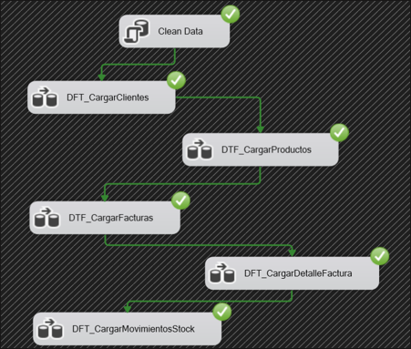
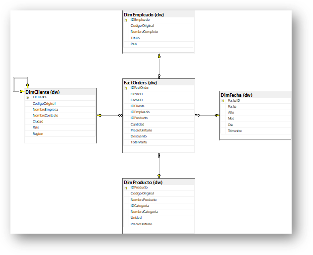
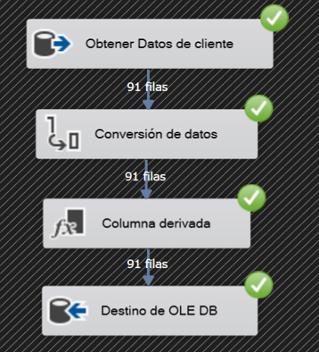
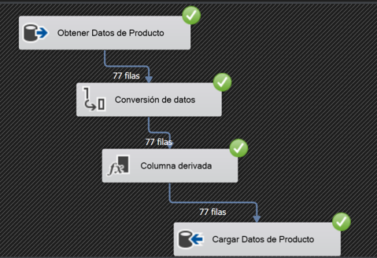
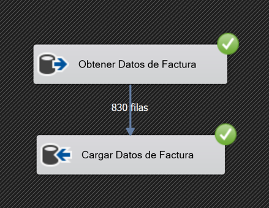
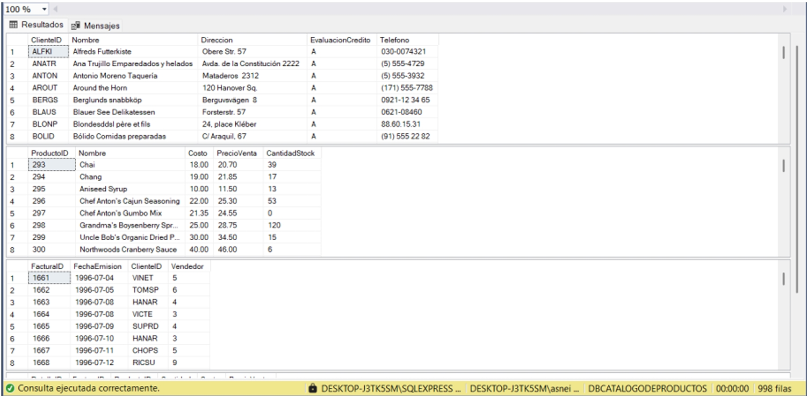

# Northwind Data Warehouse — SSIS

## Descripción del proyecto

Proyecto académico de integración de datos (ETL) y modelado dimensional, desarrollado con SQL Server Integration Services (SSIS) a partir de la base de datos de ejemplo Northwind.

El objetivo fue construir un flujo de procesamiento de datos para alimentar un almacén de datos orientado al análisis de pedidos, utilizando un modelo dimensional que facilita la organización y consulta de la información.

## Objetivos

- Aplicar el proceso ETL: extracción, transformación y carga de datos.
- Diseñar un modelo dimensional para el análisis de pedidos.
- Construir dimensiones para organizar la información de clientes, empleados, fechas y productos.
- Utilizar SSIS para implementar procesos de carga de datos.

## Arquitectura de datos

El proyecto utiliza Northwind como fuente de datos y `DWHNorthwindOrders` como almacén de datos.

El modelo dimensional documentado utiliza un esquema en estrella compuesto por las siguientes entidades:

**Dimensiones**
- `DimCliente`
- `DimEmpleado`
- `DimFecha`
- `DimProducto`

**Tabla de hechos**
- `FactOrders`

La tabla de hechos organiza la información de los pedidos junto con las dimensiones utilizadas para su análisis.

## Tecnologías

- Microsoft SQL Server
- SQL Server Integration Services (SSIS)
- Visual Studio con herramientas de proyectos SSIS
- SQL y modelado dimensional

## Contenido del repositorio

El repositorio contiene los archivos del proyecto SSIS, entre ellos:

- `CargaDimensiones.dtsx`: paquete de SSIS destinado a la carga de dimensiones.
- `Carga_de_dimensiones_del_almacen_de_dattos.dtproj`: archivo del proyecto SSIS.
- `Carga_de_dimensiones_del_almacen_de_dattos.sln`: solución de Visual Studio.
- `Project.params`: archivo de parámetros del proyecto.

También incluye un archivo `.gitignore` para excluir archivos auxiliares y configuraciones locales del entorno de desarrollo.

## Estado y reproducibilidad

Este repositorio corresponde a un proyecto académico. Actualmente contiene el paquete de carga de dimensiones, pero no se ha verificado que incluya todos los componentes necesarios para reproducir el flujo ETL completo.

Para intentar reproducirlo será necesario revisar la disponibilidad de la base de datos de origen, la configuración del almacén de datos, las conexiones y los componentes de SSIS.

La ejecución completa desde una instalación limpia queda pendiente de validación.

## Contexto académico

Este proyecto se desarrolló como parte de actividades académicas relacionadas con bases de datos, procesos ETL y almacenes de datos.

El repositorio se mantiene como registro del trabajo realizado y como proyecto de aprendizaje en integración y procesamiento de datos.

## Evidencias del proyecto

Las siguientes capturas documentan aspectos del proceso ETL y del almacén de datos durante el desarrollo académico del proyecto.

### Flujo general de ETL

El diagrama muestra la secuencia de tareas de integración y las marcas de ejecución satisfactoria registradas en la evidencia original.

### Modelo dimensional

El esquema en estrella sitúa `FactOrders` en el centro y la relaciona con las dimensiones de clientes, empleados, fechas y productos.

### Carga de clientes

La captura documenta el flujo de extracción, conversión, transformación y carga de clientes. La evidencia muestra 91 filas procesadas en las etapas representadas.

### Carga de productos

La captura documenta el procesamiento y la carga de productos. La evidencia muestra 77 filas en las etapas representadas.

### Carga de facturas

La captura documenta el flujo de carga de facturas y muestra 830 filas entre las etapas representadas.

### Resultados SQL

La captura muestra resultados de consultas SQL y el mensaje de ejecución correcta visible en el entorno original.

Estas imágenes constituyen evidencias históricas del trabajo realizado. No garantizan que el proyecto pueda ejecutarse actualmente desde una instalación limpia ni que se obtengan los mismos resultados en otro entorno.